# Poly Haven: Interiors HDRIs

**110 assets from [Poly Haven](https://polyhaven.com), dedicated to the public domain under [CC0](https://polyhaven.com/license).** Use them in any game, free or paid, and change them however you like; no credit is needed.

HDRI skies and environments as 1K and 2K Radiance `.hdr` images, for lighting and backgrounds. 899.3 MB in all.

This is a copy kept by [zuujis-cc0](https://github.com/zuujis-cc0) so game makers can take single files from GitHub. It is not made by or affiliated with Poly Haven: the originals, often in more formats and higher resolutions, are on [polyhaven.com](https://polyhaven.com). If they help you, consider [supporting Poly Haven](https://www.patreon.com/polyhaven/overview).

Every file is listed in [MANIFEST.tsv](MANIFEST.tsv) with its size and SHA-256. More free assets: [the Zuujis collection](https://github.com/zuujis-cc0/free-game-assets#readme).

| | | | |
| :-: | :-: | :-: | :-: |
| <a href="aerodynamics_workshop">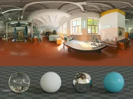</a> <b><a href="aerodynamics_workshop">Aerodynamics Workshop</a></b> by Oliksiy Yakovlyev · <a href="https://polyhaven.com/a/aerodynamics_workshop">source</a> | <a href="afrikaans_church_interior">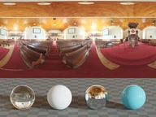</a> <b><a href="afrikaans_church_interior">Afrikaans Church Interior</a></b> by Dimitrios Savva, Jarod Guest · <a href="https://polyhaven.com/a/afrikaans_church_interior">source</a> | <a href="aft_lounge">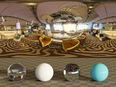</a> <b><a href="aft_lounge">Aft Lounge</a></b> by Greg Zaal · <a href="https://polyhaven.com/a/aft_lounge">source</a> | <a href="aircraft_workshop_01">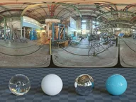</a> <b><a href="aircraft_workshop_01">Aircraft Workshop 01</a></b> by Oliksiy Yakovlyev · <a href="https://polyhaven.com/a/aircraft_workshop_01">source</a> |
| <a href="alte_veste_station">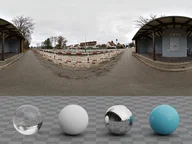</a> <b><a href="alte_veste_station">Alte Veste Station</a></b> by Elvis Posa · <a href="https://polyhaven.com/a/alte_veste_station">source</a> | <a href="anniversary_lounge">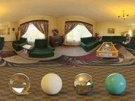</a> <b><a href="anniversary_lounge">Anniversary Lounge</a></b> by Greg Zaal · <a href="https://polyhaven.com/a/anniversary_lounge">source</a> | <a href="art_studio">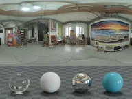</a> <b><a href="art_studio">Art Studio</a></b> by Oliksiy Yakovlyev · <a href="https://polyhaven.com/a/art_studio">source</a> | <a href="artist_workshop">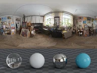</a> <b><a href="artist_workshop">Artist Workshop</a></b> by Oliksiy Yakovlyev · <a href="https://polyhaven.com/a/artist_workshop">source</a> |
| <a href="auto_service">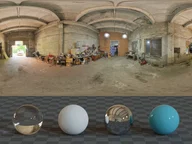</a> <b><a href="auto_service">Auto Service</a></b> by Sergej Majboroda · <a href="https://polyhaven.com/a/auto_service">source</a> | <a href="autoshop_01">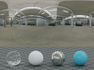</a> <b><a href="autoshop_01">Autoshop 01</a></b> by Oliksiy Yakovlyev · <a href="https://polyhaven.com/a/autoshop_01">source</a> | <a href="ballroom">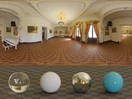</a> <b><a href="ballroom">Ballroom</a></b> by Sergej Majboroda · <a href="https://polyhaven.com/a/ballroom">source</a> | <a href="bank_vault">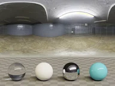</a> <b><a href="bank_vault">Bank Vault</a></b> by Dimitrios Savva, Jarod Guest · <a href="https://polyhaven.com/a/bank_vault">source</a> |
| <a href="basement_boxing_ring">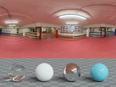</a> <b><a href="basement_boxing_ring">Basement Boxing Ring</a></b> by Sergej Majboroda · <a href="https://polyhaven.com/a/basement_boxing_ring">source</a> | <a href="bathroom">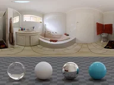</a> <b><a href="bathroom">Bathroom</a></b> by Greg Zaal · <a href="https://polyhaven.com/a/bathroom">source</a> | <a href="bell_tower">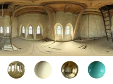</a> <b><a href="bell_tower">Bell Tower</a></b> by Dario Barresi · <a href="https://polyhaven.com/a/bell_tower">source</a> | <a href="billiard_hall">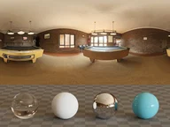</a> <b><a href="billiard_hall">Billiard Hall</a></b> by Greg Zaal, Jarod Guest · <a href="https://polyhaven.com/a/billiard_hall">source</a> |
| <a href="blender_institute">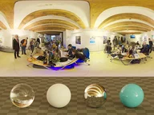</a> <b><a href="blender_institute">Blender Institute</a></b> by Greg Zaal · <a href="https://polyhaven.com/a/blender_institute">source</a> | <a href="blinds">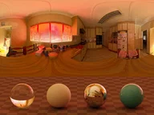</a> <b><a href="blinds">Blinds</a></b> by Greg Zaal · <a href="https://polyhaven.com/a/blinds">source</a> | <a href="boiler_room">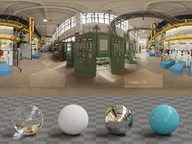</a> <b><a href="boiler_room">Boiler Room</a></b> by Oliksiy Yakovlyev · <a href="https://polyhaven.com/a/boiler_room">source</a> | <a href="boma">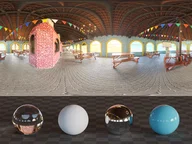</a> <b><a href="boma">Boma</a></b> by Greg Zaal, Jarod Guest · <a href="https://polyhaven.com/a/boma">source</a> |
| <a href="bush_restaurant">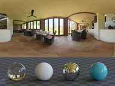</a> <b><a href="bush_restaurant">Bush Restaurant</a></b> by Greg Zaal · <a href="https://polyhaven.com/a/bush_restaurant">source</a> | <a href="cabin">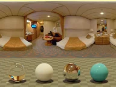</a> <b><a href="cabin">Cabin</a></b> by Greg Zaal · <a href="https://polyhaven.com/a/cabin">source</a> | <a href="carpentry_shop_01">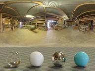</a> <b><a href="carpentry_shop_01">Carpentry Shop 01</a></b> by Greg Zaal · <a href="https://polyhaven.com/a/carpentry_shop_01">source</a> | <a href="carpentry_shop_02">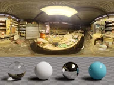</a> <b><a href="carpentry_shop_02">Carpentry Shop 02</a></b> by Greg Zaal · <a href="https://polyhaven.com/a/carpentry_shop_02">source</a> |
| <a href="castle_zavelstein_cellar">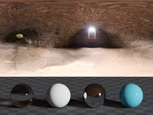</a> <b><a href="castle_zavelstein_cellar">Castle Zavelstein Cellar</a></b> by Andreas Mischok · <a href="https://polyhaven.com/a/castle_zavelstein_cellar">source</a> | <a href="cayley_interior">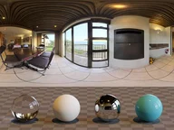</a> <b><a href="cayley_interior">Cayley Interior</a></b> by Greg Zaal · <a href="https://polyhaven.com/a/cayley_interior">source</a> | <a href="chapel_day">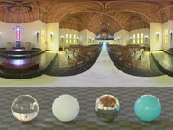</a> <b><a href="chapel_day">Chapel Day</a></b> by Dimitrios Savva, Jarod Guest · <a href="https://polyhaven.com/a/chapel_day">source</a> | <a href="childrens_hospital">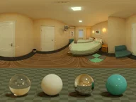</a> <b><a href="childrens_hospital">Children's Hospital</a></b> by Oliksiy Yakovlyev · <a href="https://polyhaven.com/a/childrens_hospital">source</a> |
| <a href="church_meeting_room">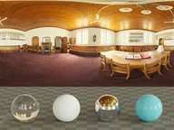</a> <b><a href="church_meeting_room">Church Meeting Room</a></b> by Dario Barresi · <a href="https://polyhaven.com/a/church_meeting_room">source</a> | <a href="church_museum">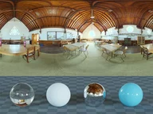</a> <b><a href="church_museum">Church Museum</a></b> by Dario Barresi · <a href="https://polyhaven.com/a/church_museum">source</a> | <a href="church_stairway">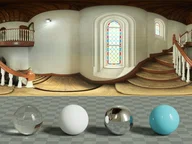</a> <b><a href="church_stairway">Church Stairway</a></b> by Dario Barresi · <a href="https://polyhaven.com/a/church_stairway">source</a> | <a href="cinema_hall">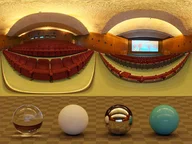</a> <b><a href="cinema_hall">Cinema Hall</a></b> by Sergej Majboroda · <a href="https://polyhaven.com/a/cinema_hall">source</a> |
| <a href="cinema_lobby">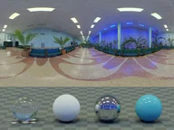</a> <b><a href="cinema_lobby">Cinema Lobby</a></b> by Sergej Majboroda · <a href="https://polyhaven.com/a/cinema_lobby">source</a> | <a href="circus_arena">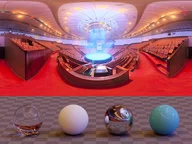</a> <b><a href="circus_arena">Circus Arena</a></b> by Oliksiy Yakovlyev · <a href="https://polyhaven.com/a/circus_arena">source</a> | <a href="climbing_gym">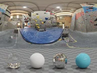</a> <b><a href="climbing_gym">Climbing Gym</a></b> by Dimitrios Savva, Jarod Guest · <a href="https://polyhaven.com/a/climbing_gym">source</a> | <a href="combination_room">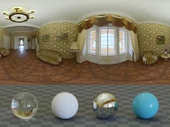</a> <b><a href="combination_room">Combination Room</a></b> by Sergej Majboroda · <a href="https://polyhaven.com/a/combination_room">source</a> |
| <a href="comfy_cafe">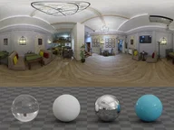</a> <b><a href="comfy_cafe">Comfy Café</a></b> by Sergej Majboroda · <a href="https://polyhaven.com/a/comfy_cafe">source</a> | <a href="country_club">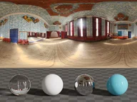</a> <b><a href="country_club">Country Club</a></b> by Sergej Majboroda · <a href="https://polyhaven.com/a/country_club">source</a> | <a href="cowboy_town_hall">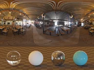</a> <b><a href="cowboy_town_hall">Cowboy Town Hall</a></b> by Dimitrios Savva, Jarod Guest · <a href="https://polyhaven.com/a/cowboy_town_hall">source</a> | <a href="cowboy_town_saloon">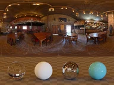</a> <b><a href="cowboy_town_saloon">Cowboy Town Saloon</a></b> by Dimitrios Savva, Jarod Guest · <a href="https://polyhaven.com/a/cowboy_town_saloon">source</a> |
| <a href="crossfit_gym">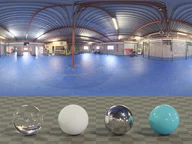</a> <b><a href="crossfit_gym">Crossfit Gym</a></b> by Dimitrios Savva, Jarod Guest · <a href="https://polyhaven.com/a/crossfit_gym">source</a> | <a href="dancing_hall">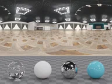</a> <b><a href="dancing_hall">Dancing Hall</a></b> by Sergej Majboroda · <a href="https://polyhaven.com/a/dancing_hall">source</a> | <a href="de_balie">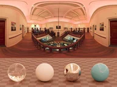</a> <b><a href="de_balie">De Balie</a></b> by Greg Zaal · <a href="https://polyhaven.com/a/de_balie">source</a> | <a href="decor_shop">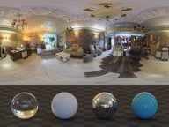</a> <b><a href="decor_shop">Decor Shop</a></b> by Sergej Majboroda · <a href="https://polyhaven.com/a/decor_shop">source</a> |
| <a href="drachenfels_cellar">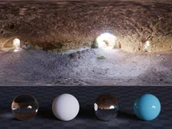</a> <b><a href="drachenfels_cellar">Drachenfels Cellar</a></b> by Andreas Mischok · <a href="https://polyhaven.com/a/drachenfels_cellar">source</a> | <a href="dresden_station_night">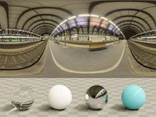</a> <b><a href="dresden_station_night">Dresden Station Night</a></b> by Greg Zaal · <a href="https://polyhaven.com/a/dresden_station_night">source</a> | <a href="empty_play_room">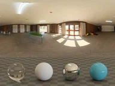</a> <b><a href="empty_play_room">Empty Play Room</a></b> by Greg Zaal, Jarod Guest · <a href="https://polyhaven.com/a/empty_play_room">source</a> | <a href="empty_workshop">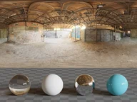</a> <b><a href="empty_workshop">Empty Workshop</a></b> by Sergej Majboroda · <a href="https://polyhaven.com/a/empty_workshop">source</a> |
| <a href="en_suite">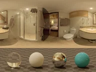</a> <b><a href="en_suite">En Suite</a></b> by Greg Zaal · <a href="https://polyhaven.com/a/en_suite">source</a> | <a href="entrance_hall">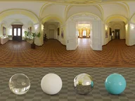</a> <b><a href="entrance_hall">Entrance Hall</a></b> by Sergej Majboroda · <a href="https://polyhaven.com/a/entrance_hall">source</a> |  <b><a href="events_hall_interior">Events Hall Interior</a></b> by Dimitrios Savva, Jarod Guest · <a href="https://polyhaven.com/a/events_hall_interior">source</a> |  <b><a href="fireplace">Fireplace</a></b> by Greg Zaal · <a href="https://polyhaven.com/a/fireplace">source</a> |
|  <b><a href="garage">Garage</a></b> by Greg Zaal · <a href="https://polyhaven.com/a/garage">source</a> |  <b><a href="gear_store">Gear Store</a></b> by Dimitrios Savva, Jarod Guest · <a href="https://polyhaven.com/a/gear_store">source</a> |  <b><a href="glasshouse_interior">Glasshouse Interior</a></b> by Dario Barresi · <a href="https://polyhaven.com/a/glasshouse_interior">source</a> |  <b><a href="graaff_reinet_groote_kerk">Graaff Reinet Groote Kerk</a></b> by Dario Barresi · <a href="https://polyhaven.com/a/graaff_reinet_groote_kerk">source</a> |
|  <b><a href="gym_01">Gym 01</a></b> by Sergej Majboroda · <a href="https://polyhaven.com/a/gym_01">source</a> |  <b><a href="gym_entrance">Gym Entrance</a></b> by Sergej Majboroda · <a href="https://polyhaven.com/a/gym_entrance">source</a> |  <b><a href="hall_of_finfish">Hall of Finfish</a></b> by Oliksiy Yakovlyev · <a href="https://polyhaven.com/a/hall_of_finfish">source</a> |  <b><a href="hall_of_mammals">Hall of Mammals</a></b> by Oliksiy Yakovlyev · <a href="https://polyhaven.com/a/hall_of_mammals">source</a> |
|  <b><a href="hamburg_hbf">Hamburg Hbf</a></b> by Greg Zaal · <a href="https://polyhaven.com/a/hamburg_hbf">source</a> |  <b><a href="hayloft">Hayloft</a></b> by Adrian Kubasa · <a href="https://polyhaven.com/a/hayloft">source</a> |  <b><a href="historic_cloister_passage">Historic Cloister Passage</a></b> by Elvis Posa · <a href="https://polyhaven.com/a/historic_cloister_passage">source</a> |  <b><a href="hospital_room">Hospital Room</a></b> by Oliksiy Yakovlyev · <a href="https://polyhaven.com/a/hospital_room">source</a> |
|  <b><a href="hospital_room_2">Hospital Room 2</a></b> by Dimitrios Savva, Jarod Guest · <a href="https://polyhaven.com/a/hospital_room_2">source</a> |  <b><a href="hotel_room">Hotel Room</a></b> by Greg Zaal · <a href="https://polyhaven.com/a/hotel_room">source</a> |  <b><a href="indoor_pool">Indoor Pool</a></b> by Oliksiy Yakovlyev · <a href="https://polyhaven.com/a/indoor_pool">source</a> |  <b><a href="industrial_workshop_foundry">Industrial Workshop Foundry</a></b> by Dimitrios Savva, Jarod Guest · <a href="https://polyhaven.com/a/industrial_workshop_foundry">source</a> |
|  <b><a href="kart_club">Kart Club</a></b> by Sergej Majboroda · <a href="https://polyhaven.com/a/kart_club">source</a> |  <b><a href="kiara_interior">Kiara Interior</a></b> by Greg Zaal · <a href="https://polyhaven.com/a/kiara_interior">source</a> |  <b><a href="large_corridor">Large Corridor</a></b> by Sergej Majboroda · <a href="https://polyhaven.com/a/large_corridor">source</a> |  <b><a href="leadenhall_market">Leadenhall Market</a></b> by Andreas Mischok · <a href="https://polyhaven.com/a/leadenhall_market">source</a> |
|  <b><a href="lebombo">Lebombo</a></b> by Greg Zaal · <a href="https://polyhaven.com/a/lebombo">source</a> |  <b><a href="lythwood_lounge">Lythwood Lounge</a></b> by Greg Zaal · <a href="https://polyhaven.com/a/lythwood_lounge">source</a> |  <b><a href="lythwood_room">Lythwood Room</a></b> by Greg Zaal · <a href="https://polyhaven.com/a/lythwood_room">source</a> |  <b><a href="machine_shop_01">Machine Shop 01</a></b> by Sergej Majboroda · <a href="https://polyhaven.com/a/machine_shop_01">source</a> |
|  <b><a href="machine_shop_02">Machine Shop 02</a></b> by Sergej Majboroda · <a href="https://polyhaven.com/a/machine_shop_02">source</a> |  <b><a href="machine_shop_03">Machine Shop 03</a></b> by Oliksiy Yakovlyev · <a href="https://polyhaven.com/a/machine_shop_03">source</a> |  <b><a href="metro_noord">Metro: Noord</a></b> by Greg Zaal · <a href="https://polyhaven.com/a/metro_noord">source</a> |  <b><a href="metro_vijzelgracht">Metro: Vijzelgracht</a></b> by Greg Zaal · <a href="https://polyhaven.com/a/metro_vijzelgracht">source</a> |
|  <b><a href="modern_bathroom">Modern Bathroom</a></b> by Adrian Kubasa · <a href="https://polyhaven.com/a/modern_bathroom">source</a> |  <b><a href="moon_lab">Moon Lab</a></b> by Greg Zaal · <a href="https://polyhaven.com/a/moon_lab">source</a> |  <b><a href="museum_of_ethnography">Museum of Ethnography</a></b> by Oliksiy Yakovlyev · <a href="https://polyhaven.com/a/museum_of_ethnography">source</a> |  <b><a href="music_hall_01">Music Hall 01</a></b> by Sergej Majboroda · <a href="https://polyhaven.com/a/music_hall_01">source</a> |
|  <b><a href="music_hall_02">Music Hall 02</a></b> by Sergej Majboroda · <a href="https://polyhaven.com/a/music_hall_02">source</a> |  <b><a href="mutianyu">Mutianyu</a></b> by Greg Zaal · <a href="https://polyhaven.com/a/mutianyu">source</a> |  <b><a href="newman_cafeteria">Newman Cafeteria</a></b> by Savva Zakharov · <a href="https://polyhaven.com/a/newman_cafeteria">source</a> |  <b><a href="newman_lobby">Newman Lobby</a></b> by Savva Zakharov · <a href="https://polyhaven.com/a/newman_lobby">source</a> |
|  <b><a href="newman_locker_room">Newman Locker Room</a></b> by Savva Zakharov · <a href="https://polyhaven.com/a/newman_locker_room">source</a> |  <b><a href="paul_lobe_haus">Paul Lobe Haus</a></b> by Greg Zaal · <a href="https://polyhaven.com/a/paul_lobe_haus">source</a> |  <b><a href="penguin_museum">Penguin Museum</a></b> by Jenelle van Heerden · <a href="https://polyhaven.com/a/penguin_museum">source</a> |  <b><a href="phone_shop">Phone Shop</a></b> by Philip Modin · <a href="https://polyhaven.com/a/phone_shop">source</a> |
|  <b><a href="pillars">Pillars</a></b> by Greg Zaal · <a href="https://polyhaven.com/a/pillars">source</a> |  <b><a href="pine_attic">Pine Attic</a></b> by Sergej Majboroda · <a href="https://polyhaven.com/a/pine_attic">source</a> |  <b><a href="poly_haven_studio">Poly Haven Studio</a></b> by Greg Zaal · <a href="https://polyhaven.com/a/poly_haven_studio">source</a> |  <b><a href="pretville_cinema">Pretville Cinema</a></b> by Dimitrios Savva, Jarod Guest · <a href="https://polyhaven.com/a/pretville_cinema">source</a> |
|  <b><a href="pump_house">Pump House</a></b> by Greg Zaal · <a href="https://polyhaven.com/a/pump_house">source</a> |  <b><a href="reading_room">Reading Room</a></b> by Greg Zaal · <a href="https://polyhaven.com/a/reading_room">source</a> |  <b><a href="relax_inn_seaview_suite">Relax Inn Seaview Suite</a></b> by Dario Barresi, Jenelle van Heerden · <a href="https://polyhaven.com/a/relax_inn_seaview_suite">source</a> |  <b><a href="rostock_arches">Rostock Arches</a></b> by Greg Zaal · <a href="https://polyhaven.com/a/rostock_arches">source</a> |
|  <b><a href="rostock_laage_airport">Rostock-Laage Airport</a></b> by Greg Zaal · <a href="https://polyhaven.com/a/rostock_laage_airport">source</a> |  <b><a href="royal_esplanade">Royal Esplanade</a></b> by Greg Zaal · <a href="https://polyhaven.com/a/royal_esplanade">source</a> |  <b><a href="school_hall">School Hall</a></b> by Dimitrios Savva, Jarod Guest · <a href="https://polyhaven.com/a/school_hall">source</a> |  <b><a href="school_quad">School Quad</a></b> by Dimitrios Savva, Jarod Guest · <a href="https://polyhaven.com/a/school_quad">source</a> |
|  <b><a href="sculpture_exhibition">Sculpture Exhibition</a></b> by Oliksiy Yakovlyev · <a href="https://polyhaven.com/a/sculpture_exhibition">source</a> |  <b><a href="sepulchral_chapel_basement">Sepulchral Chapel Basement</a></b> by Andreas Mischok · <a href="https://polyhaven.com/a/sepulchral_chapel_basement">source</a> |  <b><a href="sepulchral_chapel_rotunda">Sepulchral Chapel Rotunda</a></b> by Andreas Mischok · <a href="https://polyhaven.com/a/sepulchral_chapel_rotunda">source</a> |  <b><a href="small_cathedral">Small Cathedral</a></b> by Sergej Majboroda · <a href="https://polyhaven.com/a/small_cathedral">source</a> |
|  <b><a href="small_empty_house">Small Empty House</a></b> by Greg Zaal · <a href="https://polyhaven.com/a/small_empty_house">source</a> |  <b><a href="small_empty_room_1">Small Empty Room 1</a></b> by Sergej Majboroda · <a href="https://polyhaven.com/a/small_empty_room_1">source</a> |  |  |

---

Kept up to date by this repository's own [update workflow](.github/workflows/update.yml), with code and plan from [cc0-mirror](https://github.com/zuujis-cc0/cc0-mirror). Something wrong? [Open an issue there](https://github.com/zuujis-cc0/cc0-mirror/issues/new) or use the [private report form](https://games.zuujis.com/report).
